# 수업 교구 재구성 계획서 (v3)

- **문서 버전**: v3.1 — 0단계 · 1단계 개발 완료, **선생님 확인 ① 대기** (10장)
- **작성일**: 2026-11-15
- **저장소**: `YANGHYEOKJIN33/AI` (이전 이름 `Fundamentals-of-AI`) · 브랜치 `claude/busy-albattani-x9og7b`
- **⚠ 화면 형태는 [PLAN-v4.md](./PLAN-v4.md)로 바뀌었다** (2026-11-16) — 슬라이드형 수업 화면 대신 사이트 형태를 유지하고 보이는 정보를 줄인다. 이 문서의 점검 결과 · 수업 내용 · 보완 자료는 그대로 쓴다.
- **앞선 계획**: [PLAN.md](./PLAN.md) (v1.1 ~ v2.1, 학습 사이트로서의 계획과 기록)
- **함께 보는 문서**: [차시별 장면 구성안](./docs/plan-v3/SCENES.md) · 화면 시안 그림 `docs/plan-v3/m01 ~ m11`

---

## 0. 한눈에 보기

| | |
|---|---|
| **무엇이 문제인가** | 지금 사이트는 학생이 자기 화면에서 혼자 눌러 보는 **학습용 웹앱**으로 설계되었다. 교실 앞 화면에 띄워 놓고 설명하기에는 글자가 작고, 한 화면에 구획이 많고, 한 번 누를 때 여러 곳이 동시에 바뀐다. 개념 설명 · 발문 · 활동 · 정리가 화면 안에 없어 이 자료만으로는 수업을 끌고 갈 수 없다. |
| **먼저 알릴 것** | 공개 주소(`yanghyeokjin33.github.io/AI/`)에 지금 보이는 것은 **10월 23일의 첫 버전**이다. 10월 24일 · 25일의 두 차례 개편은 저장소에만 있고 게시되지 않았다(2.1절). |
| **어떻게 바꾸나** | 사이트의 중심을 **수업 화면(슬라이드처럼 넘기는 큰 무대)** 으로 바꾼다. ① 한 화면에 하나 ② 한 번 누르면 한 가지만 바뀜 ③ 전과 후를 함께 보여 줌 ④ 뒷자리에서도 읽히는 글자 ⑤ 개념부터 풀어 쓴 설명 ⑥ 목표 · 발문 · 활동지 · 확인 문제 · 교사 노트까지 화면 안에. |
| **수업 편성** | 기본 **6차시** — k-NN 1 · k-평균 1 · 선형회귀 2 · 의사결정트리 2 (차시당 33 ~ 43장면). 선택 차시 2개(준비 · 종합). 4차시로 줄이는 길도 함께 만든다. |
| **살리는 것** | 검산된 알고리즘 엔진, 예제 데이터, 시험 문제 생성기와 추적표, 용어 사전, 테스트. 지금 화면들은 "연습" 메뉴로 옮긴다. |
| **진행 방법** | 먼저 게시를 바로잡고(0단계), **1차시(k-NN)를 시범 차시로 끝까지** 만든 뒤 선생님 확인을 받고 나머지 차시로 넓힌다(10장). |
| **선생님이 정해 주실 것** | 차시 수, 수업 방식(교사 화면 중심인지), 교실 화면, 기존 자습 화면 유지 여부 등 9가지(11장). 답이 없으면 적어 둔 기본값으로 진행한다. |

같은 순간(선형회귀에서 w를 고치는 줄)의 세 화면:

| 지금 공개 주소에 보이는 화면 (10/23 버전) | 저장소 최신본 (10/25, 미게시) | v3 수업 화면 시안 |
|---|---|---|
| 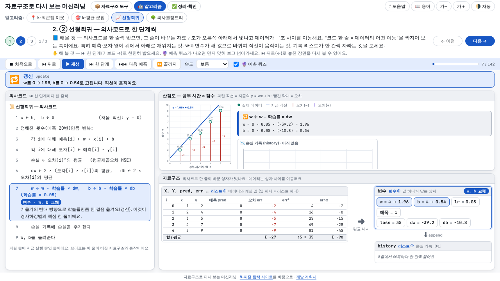 | 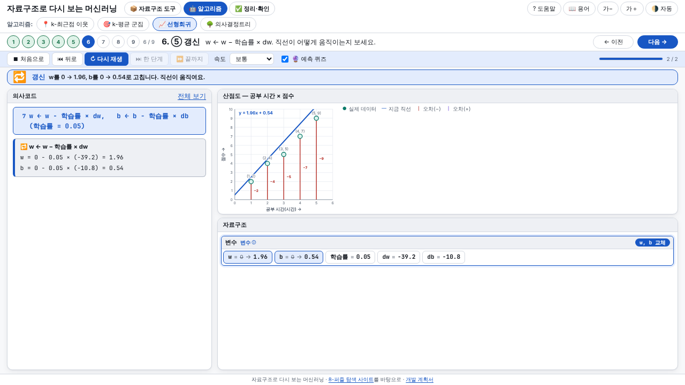 | 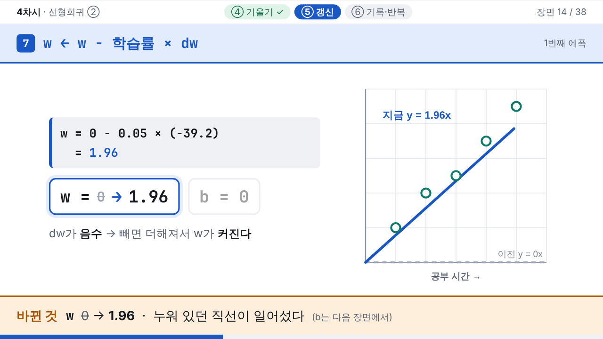 |

---

## 1. 요청과 이 문서의 대응

| 요청 | 이 문서에서 |
|---|---|
| 1. 한 번에 시각 정보가 너무 많고, 무엇이 어떻게 바뀌는지 알기 어렵다 | 2.2절(측정), 3장 원칙 ① ② ③, 4장(화면 설계 · 변화 표현 규칙) |
| 2. 4차시 이상 수업, 내용을 최대한 풀어서 | 5장(6차시 편성), [장면 구성안](./docs/plan-v3/SCENES.md)(차시별 33 ~ 43장면) |
| 3. 이 자료만으로 수업할 수 있는 화면 | 4장(화면 틀 · 조작 · 교사 노트), 6장(활동지 · 대본 · 확인 문제) |
| 4. 목표: 알고리즘 개념 이해 + 자료구조 안에서 데이터가 변하는 모습 이해 | 3장 원칙 ⑤, 5.2절(차시의 얼개: 개념 → 자료구조로 따라가기) |
| 5. 교구로 쓰기 알맞은 형태로 재구성하는 계획 | 문서 전체, 10장(개발 단계) |
| 6. 사이트 파일 점검, 수업 자료로 부족한 부분 보완 | 2장(점검 결과), 6장(보완할 자료) |
| 7. 지시 외에 고칠 부분 | 8장(18건) |
| 8. 이번에는 계획만 | 사이트 코드 변경 없음. 추가한 것은 이 문서와 `docs/plan-v3/`(장면 구성안 · 시안 그림)뿐 |

---

## 2. 점검 결과

저장소의 모든 파일과, 사이트를 실제로 띄워 41쪽 전부를 교실 화면 크기(1280×720, 1920×1080)로 넘겨 보며 점검했다. 수치는 브라우저 자동 측정값이다(부록).

### 2.1 게시 상태 — 공개 주소에는 첫 버전이 떠 있다

| 사실 | 근거 |
|---|---|
| 공개 주소 `https://yanghyeokjin33.github.io/AI/` 의 파일은 10월 23일 커밋 `de5a882`와 같다 | 게시된 파일 5개를 커밋별로 대조. 10/24에 추가한 `src/core/exam.js`는 404, 10/24에 지운 `src/ui/tools/mapRoom.js`는 200 |
| 게시는 한 번만 실행되었다 | GitHub Actions 기록: "Deploy to GitHub Pages" 1회(2026-10-24 07:35 UTC, 직접 실행). 이후 10/24 · 10/25의 push는 테스트만 실행 |
| 까닭 | `deploy.yml`이 `main` 브랜치에 올릴 때만 자동 실행되는데, 저장소에는 `main`이 없다(브랜치는 `claude/busy-albattani-x9og7b` 하나) |
| 옛 주소는 열리지 않는다 | 저장소 이름이 바뀌어 `…/Fundamentals-of-AI/`는 404. 문서와 화면 아래 링크 6곳이 옛 주소다 |

따라서 **"도구 미션 · 시험형 예제 · 추적표 · 파이썬 제거"(10/24)와 "한 줄 단위 쪽 나누기 · 글 줄이기 · 실행 전 모습"(10/25)은 공개 주소에서 본 적이 없는 상태**일 가능성이 높다. 알고리즘 탭의 쪽 번호가 3개(① 한눈에 복습 ② 의사코드 ③ 파이썬)로 보이면 첫 버전이다.

- 지금 바로 최신본을 보려면: GitHub 저장소 → **Actions** → **Deploy to GitHub Pages** → **Run workflow**. (요청하시면 대신 실행한다. 코드 변경은 없다.)
- 다만 최신본도 아래 2.2 ~ 2.3절의 문제는 그대로이므로, 이 계획의 방향은 달라지지 않는다.

### 2.2 화면 정보량 — 숫자로 본 "너무 많다"

알고리즘 단계 화면 기준, 1280×720.

| 항목 | 공개 주소의 첫 버전 | 저장소 최신본 | v3 수업 화면 목표 |
|---|---|---|---|
| 화면에 보이는 글자 수 | 약 1,400 ~ 1,540자 | 약 690자 | **250자 이하** |
| 12px보다 작은 글자의 비율 | 82 ~ 85% | 82% | **0%** |
| 가장 작은 글자 | 5.5 ~ 6.5px (그림 속 이름표) | 6.4px | **17px 이상** (화면 높이의 2.4%) |
| 본문 글자 | 약 12px | 약 12px | **27px** (화면 높이의 3.8%) |
| 위쪽 막대 | 5줄 (제목 · 알고리즘 탭 · 쪽 안내 · 실행 제어 · 동작 카드) | 5줄 | **1줄** |
| 패널 · 상자 | 8 ~ 9개 | 평균 6.7개 | **1 ~ 2개 + 자막 한 줄** |
| 단추 · 선택 상자 | 28 ~ 29개 | 평균 32개 | **3개 이하** |
| ⏭ 한 번에 바뀌는 구획 (의사코드 · 그림 · 자료구조 · 해설 4곳 중) | 3.94 ~ 4.00곳 | 평균 3.17곳 | **1곳 + 자막** |

- 1920×1080에서도 최신본의 본문은 약 16px, 가장 작은 글자는 8.8px이다.
- "무엇이 어떻게 바뀌는지 알기 어렵다"의 원인은 마지막 줄이다. 한 번 누를 때 강조 줄, 계산, 그림, 자료구조 상자, 해설이 **서로 떨어진 곳에서 동시에** 바뀌고, 움직임은 0.4 ~ 0.8초 동안 한 번 지나간다. 설명을 듣느라 잠깐 고개를 돌린 학생은 바뀐 뒤의 모습만 본다. 이전 모습은 화면에 남지 않는다.
- 최신본은 글자 수를 절반으로 줄였지만, 화면의 짜임(3분할 + 막대 5줄)과 글자 크기는 개인 화면용 그대로다.

### 2.3 수업 자료로서 부족한 것

| 수업에 필요한 것 | 지금(최신본) | 보완 |
|---|---|---|
| 도입 — 동기 유발, 학습 목표 | 쪽 위 한 문장 | 차시마다 표지 · 목표 · 오늘의 문제 장면 |
| 개념 설명 — 왜, 무엇을 | "문제 보기" 한 쪽에 문제 · 입출력 · 시험 팁. 거리 · 평균 · 오차를 제곱하는 까닭 · 손실 · 불순도 · 재귀를 풀어 주는 화면이 없다 | 차시마다 개념 장면 8 ~ 14개 |
| 손으로 따라 하는 계산 | 계산 상자에 결과가 한꺼번에 나온다 | 계산을 한 줄씩 + 활동지 |
| 자료구조 자체의 설명 | 📦 도구 6개(혼자 하는 실습). **스택은 없다** | 차시마다 "오늘 쓸 자료구조" 장면, 준비 차시, 스택 추가 |
| 발문과 예상 답 | `docs/TEACHER.md`에 8개 — 사이트 밖 문서이고 3차시 기준이다 | 장면마다 교사 노트(설명 · 발문 · 예상 답 · 자주 하는 오해 · 시간) |
| 학생 활동 | 화면 속 추적표(칸을 눌러 답 보기) | 인쇄용 활동지 · 정답지 |
| 형성 평가 | 시험 대비 연습(혼자 푸는 화면, 작은 글씨) | 차시 끝 확인 문제 3개(큰 화면, 정답 공개형) |
| 정리, 다음 차시 예고 | 네 알고리즘 한 장 정리 하나 | 차시마다 한 장 정리 + 다음 시간 |
| 차시 계획 | 3차시 예시 문서 | 사이트 구조 자체가 차시 |
| 수업 중 조작 | 작은 단추를 마우스로. PageDown은 "다음 반복"에 묶여 발표용 리모컨과 어긋난다. 전체 화면 없음 | 키 · 리모컨 · 터치, 전체 화면, 이어서 하기, 화면 가리기, 타이머 |

### 2.4 그대로 살릴 것

| 자산 | 상태 |
|---|---|
| 알고리즘 엔진 `src/core/algorithms` — 의사코드 한 줄마다 자료구조 모습을 기록한 장면 281개(k-NN 27 · k-평균 52 · 선형회귀 142 · 의사결정트리 60) | 테스트로 검산됨. 수업 화면의 재료로 그대로 쓴다 |
| 예제 데이터 `src/core/datasets.js` — 손 계산 크기(음식 9개, 집 6채, 공부 시간 5명, 축구 기록 14일) | 그대로 |
| 시험 문제 생성기 · 추적표 `src/core/exam.js` | 확인 문제, 활동지, 정답지의 재료로 쓴다 |
| 그림 부품(산점도 · 트리), 이동 애니메이션, 용어 사전 57개 | 재사용 |
| 줄별 설명 문장 `notes`(알고리즘마다 9 ~ 10개) | 10/25 개편에서 화면에서 빠져 쓰이지 않는다 → 교사 노트의 밑글로 되살린다 |
| 테스트 52개 | 유지하고 수업 화면용을 더한다 |

---

## 3. 재구성 방향 — 여섯 가지 원칙

1. **한 화면에 하나.** 장면마다 크게 보이는 것은 하나다(표, 리스트, 딕셔너리, 그림, 계산 중 하나). 데이터가 한 상자에서 다른 상자로 옮겨 가는 장면만 둘을 나란히 둔다.
2. **한 번 누르면 한 가지만.** →를 한 번 누르면 화면의 한 곳만 바뀐다. 의사코드 한 줄도 "줄이 켜진다 → 계산이 나온다 → 데이터가 움직인다"로 나눠 누른다.
3. **전과 후를 함께.** 바뀌기 전 값과 자리의 흔적을 남기고, 화면 아래 "바뀐 것" 자막이 한 줄로 말해 준다(`distances 2칸 → 3칸`). 놓쳤으면 한 키로 다시 본다.
4. **뒷자리에서도 읽힌다.** 수업 화면은 16:9 무대 한 장이고 창 크기에 맞춰 통째로 커진다. 무대 안의 가장 작은 글자도 화면 높이의 2.4% 이상, 본문은 3.8%다.
5. **개념부터 말로 푼다.** 차시마다 "왜 필요한가 → 손으로 한 번 → 자료구조로 따라가기 → 의사코드와 연결" 순서다. 중요한 변화 앞에는 질문을 먼저 띄우고 답은 다음 클릭에 보인다.
6. **이 화면만으로 수업한다.** 목표, 발문, 활동 안내, 정리, 확인 문제가 장면으로 들어 있고, 교사 노트 · 활동지 · 정답지 · 수업 대본을 사이트에서 바로 열고 인쇄한다.

이 기준은 말로만 두지 않는다. 글자 크기 · 글자 수 · 한 번에 바뀌는 곳의 수를 **자동 점검으로 강제**한다(9.4절).

---

## 4. 수업 화면 설계

### 4.1 무대와 글자 크기

- 무대는 1600×900(16:9)을 기준으로 그리고, 창 크기에 맞춰 통째로 확대 · 축소한다. 어떤 화면에서도 배치와 글자 비율이 같다.
- 글자 기준(무대 높이 대비): 제목 5 ~ 7%, 본문 3.8%, 자료구조 칸 3.3 ~ 3.8%, 보조 글자(칸 번호 · 단위) 2.4 ~ 2.9%. 그보다 작은 글자는 쓰지 않는다.

| 교실 화면 | 본문 | 가장 작은 글자 |
|---|---|---|
| 1280×720 | 27px | 17px |
| 1920×1080 | 41px | 26px |

- 1단계에서 **교실 가독성 점검 화면**(크기별 글자 견본)을 먼저 만들어, 실제 교실 뒷자리에서 읽히는 가장 작은 크기를 확인하고 이 기준을 확정한다.

### 4.2 화면의 자리 — 늘 같은 곳을 보게

```
┌──────────────────────────────────────────────────────────────┐
│ 1차시 · k-최근접 이웃    ① 거리 재기  ② 정렬  ③ k개  ④ 투표    16 / 43 │  위 한 줄 — 어디쯤인지
├──────────────────────────────────────────────────────────────┤
│  4   distances에 (d², 레이블)을 추가한다                        │  지금 줄 — 실행 중인 의사코드 한 줄
├──────────────────────────────────────────────────────────────┤
│                                                              │
│        [ 원본 ]      ➜      [ 바뀌는 자료구조 ]                 │  가운데 — 주인공 하나(옮길 때만 둘)
│                                                              │
├──────────────────────────────────────────────────────────────┤
│ 바뀐 것   distances  2칸 → 3칸 · 맨 뒤 [2]에 (2, 과일)          │  자막 — 방금 바뀐 것 한 줄
└──────────────────────────────────────────────────────────────┘
```

의사코드 전체는 늘 띄워 두지 않는다. 단계가 바뀔 때 **지도 장면**(의사코드 전체 + "지금 여기")으로 한 번 보여 주고, 평소에는 지금 줄 한 줄만 둔다.

### 4.3 화면 틀 12가지

| 묶음 | 틀 | 쓰임 |
|---|---|---|
| 설명 | 표지 · 목표 / 개념(한 문장 + 그림 하나) / 지도(의사코드 전체와 지금 여기) / 정리 | 수업의 처음 · 끝, 개념 풀이 |
| 데이터 | 표 / 자료구조 하나 / 이동(원본 → 대상) / 계산(한 줄씩) / 그림(산점도 · 트리) | 알고리즘을 한 줄씩 따라가기 |
| 참여 | 멈춤 질문 / 활동(활동지 번호 + 타이머) / 확인 문제 | 학생이 먼저 생각하고 쓰기 |

### 4.4 "무엇이 바뀌었나"를 보이게 하는 규칙

| 자료구조 | 바뀌는 모습 | 남기는 흔적 |
|---|---|---|
| 리스트에 추가 | 원본 칸에서 새 칸으로 천천히 날아간다(약 1초) | 새 칸에 "방금 추가" 표시, 다음 빈칸은 점선 |
| 리스트 정렬 | 정렬 전 줄과 정렬 후 줄을 위아래로 두고 선을 따라 내려온다 | 정렬 전 줄을 흐리게 남긴다 |
| 앞에서 k개 | 한 칸씩 복사 | 원본은 그대로(복사임을 보인다) |
| 딕셔너리 세기 | 새 키가 생기거나 값이 +1 | 옛 값에 줄을 긋고 새 값(`1 → 2`) |
| 변수 갱신 | 식 → 새 값 | `0 → 1.96`, 그림에는 이전 직선을 점선으로 |
| 묶음에 넣기 | 대기 줄에서 묶음으로 이동 | 지난 회차와 다른 묶음으로 간 것은 점선 테두리 |
| 스택 | 위로 쌓이고, 위에서 빠진다 | "방금 쌓임" 표시, 빠진 칸은 옆으로 나가며 사라진다 |

- 아래 자막은 언제나 `이전 → 지금` 형식으로 쓴다.
- 방금 변화를 놓쳤을 때: `R` = 같은 변화를 다시 재생, `←` = 바뀌기 전으로.

### 4.5 의사코드 한 줄을 여러 박자로

예: k-NN에서 오렌지를 처리하는 3 · 4줄.

| → | 바뀌는 곳 | 화면 |
|---|---|---|
| 1 | 지금 줄 | `3  d² ← 거리(토마토, 오렌지)` |
| 2 | 가운데(계산) | `(6−7)² + (4−3)² = 1 + 1 = 2` |
| 3 | 지금 줄 | `4  distances에 (d², 레이블)을 추가한다` |
| 4 | 가운데(이동) + 자막 | (2, 과일)이 `[2]`로 들어간다 · `2칸 → 3칸` |

처음 두세 번은 이렇게 천천히, 같은 일이 되풀이되는 구간은 한 번 누르면 한 바퀴씩 간다(그 사이에 학생은 활동지를 채우고, 화면으로 답을 맞춘다).

### 4.6 조작 — 발표용 리모컨 · 키보드 · 터치

| 하는 일 | 키 |
|---|---|
| 다음 / 이전 (한 박자) | `→` `Space` `PageDown` / `←` `PageUp` — 발표용 리모컨의 앞 · 뒤 단추와 같다 |
| 장면 단위로 건너뛰기 | `↓` / `↑` |
| 방금 변화 다시 보기 | `R` |
| 교사 노트 | `N` |
| 장면 목록(한눈에 보고 골라 가기) | `G` |
| 전체 화면 / 화면 가리기(검은 화면) | `F` / `B` |
| 활동 타이머 | `T` |
| 장면 번호로 가기 | 숫자 + `Enter` |

- 터치 화면(전자칠판)에서는 화면 오른쪽 · 왼쪽 가장자리를 누르면 다음 · 이전이다.
- 멈춘 장면을 기억해 다음에 **이어서 하기**로 연다. 장면마다 주소가 있어 특정 장면을 바로 열 수 있다.

### 4.7 교사 노트

`N`을 누르면 무대가 위로 줄어들고(아무것도 가리지 않는다) 아래에 그 장면의 **이렇게 말해요 · 이렇게 물어요 · 예상 답과 자주 하는 오해 · 시간**이 나온다. 같은 내용을 차시별 **수업 대본**으로 인쇄할 수 있다(6.3절). 화면 둘을 쓰는 교실을 위한 발표자 보기(다른 창)는 뒤 단계의 선택 사항으로 둔다.

### 4.8 화면 시안

계획용 그림이다(사이트에는 아직 없다). 원본은 `docs/plan-v3/mockups.html`.

| | |
|---|---|
| 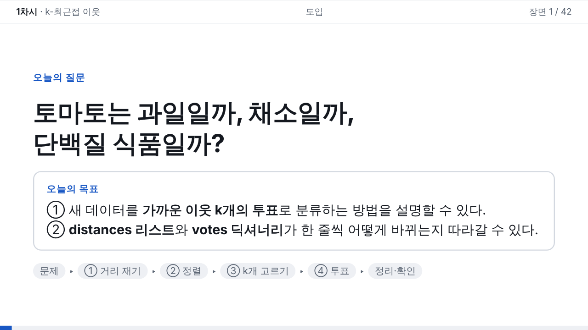 표지 · 목표 | 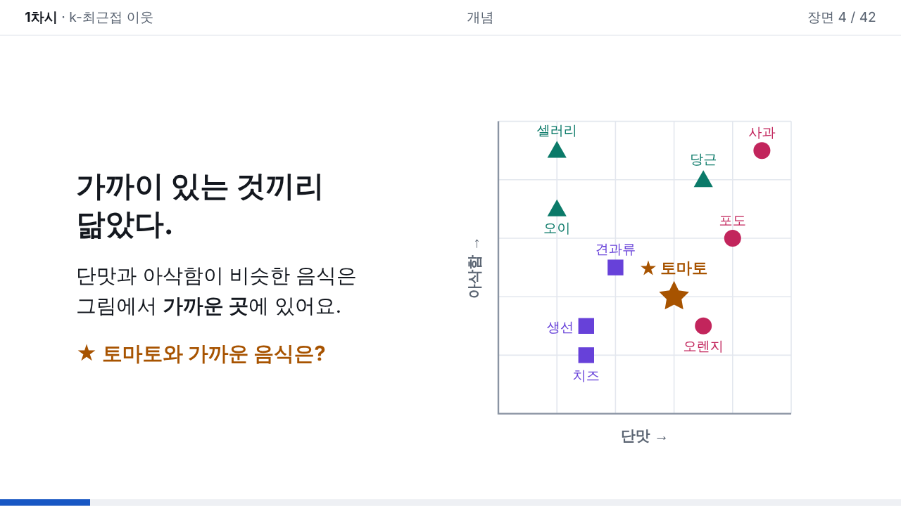 개념 — 한 문장 + 그림 하나 |
| 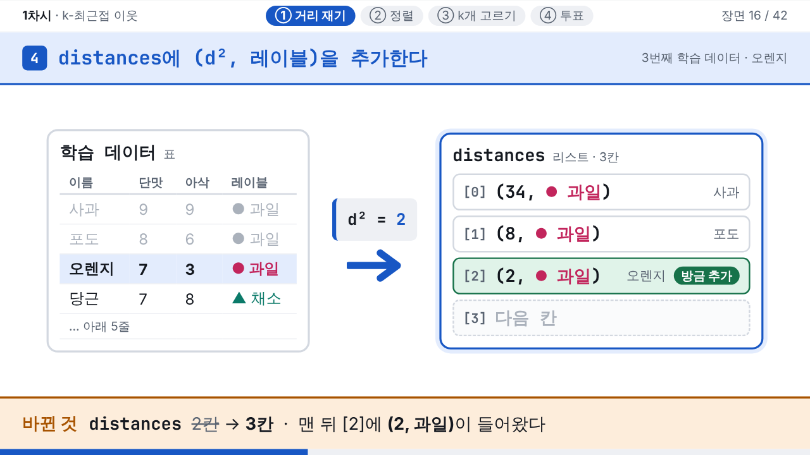 이동 — 지금 줄 · 원본 → 대상 · 바뀐 것 | 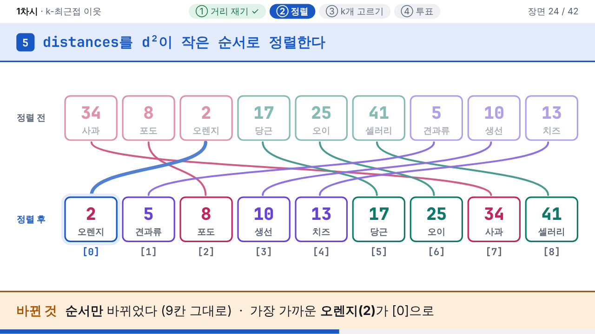 정렬 — 전과 후를 나란히 |
| 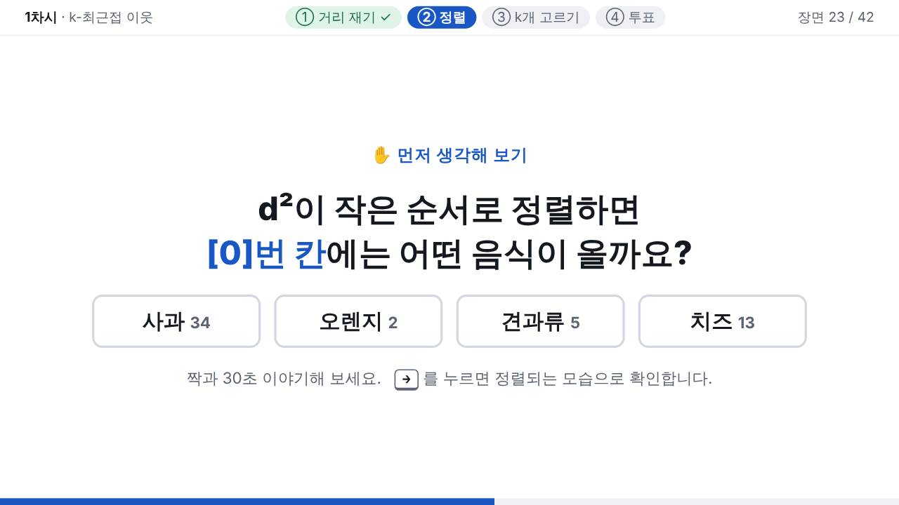 멈춤 질문 — 답은 다음 클릭에 | 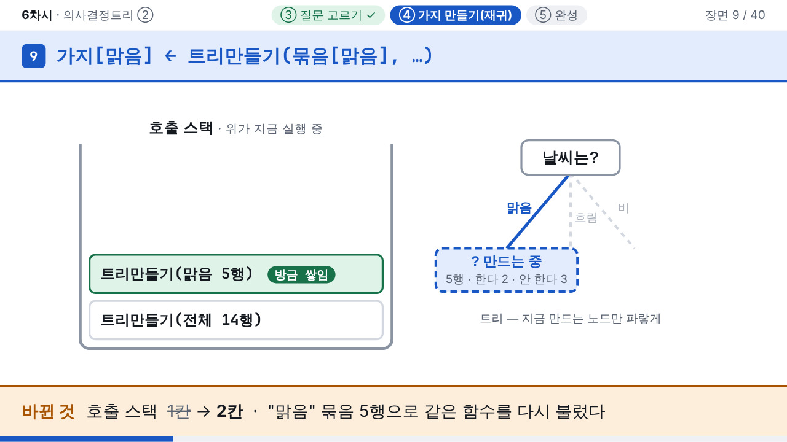 호출 스택 — 한 칸이 쌓인다 |
| 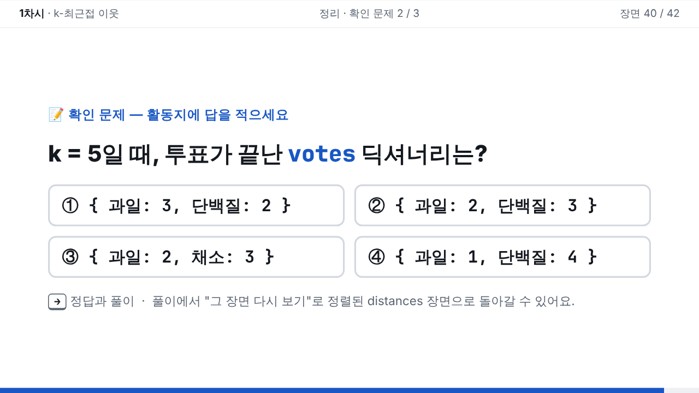 확인 문제 — 시험 형식 | 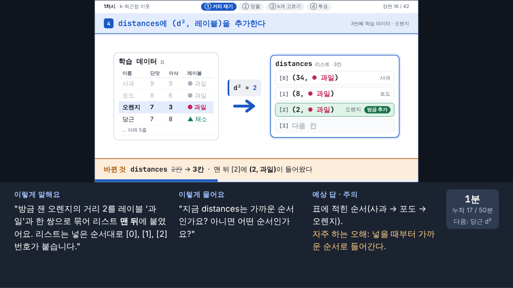 교사 노트(N) |
| 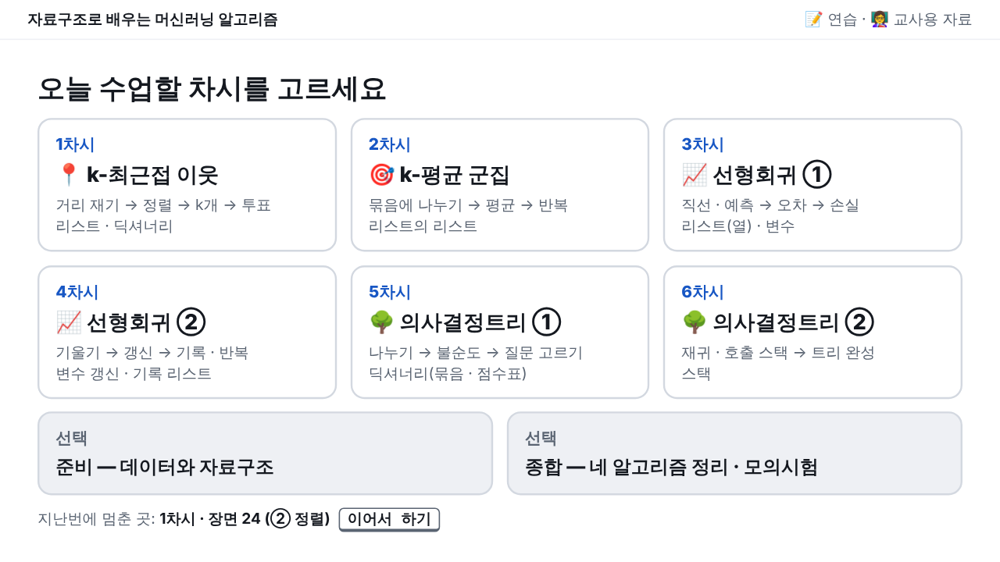 수업 홈 — 차시 고르기 | 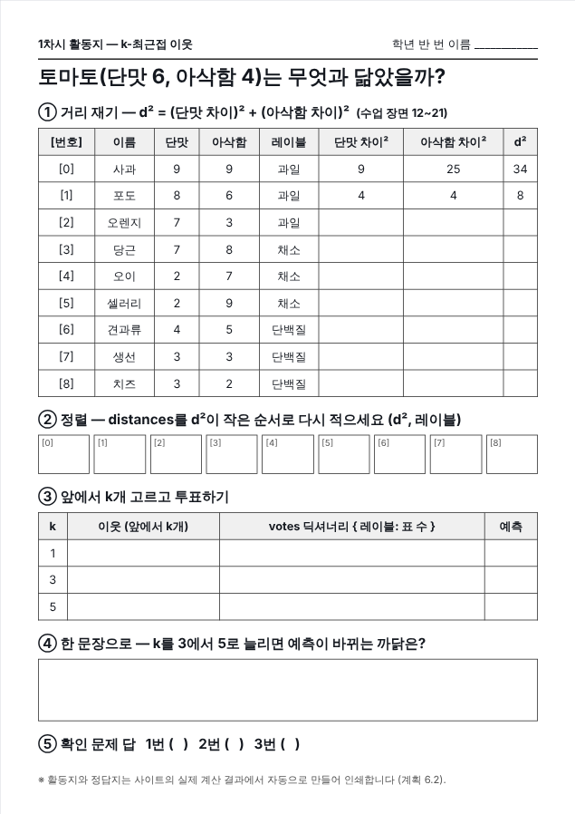 활동지(A4) |

---

## 5. 차시 구성

### 5.1 편성 — 기본 6차시

| 차시 | 주제 | 풀어 쓰는 내용 | 자료구조 | 장면 |
|---|---|---|---|---|
| 1 | k-최근접 이웃 | 분류 · 거리 제곱 · distances 만들기 · 정렬 · k개 · 투표 · k를 바꾸면 | 표, 리스트, 딕셔너리 | 43 |
| 2 | k-평균 군집 | 군집 · 평균과 중심 · 나누기 · 새 중심 · 비교 · 회차 반복 · 수렴 | 리스트의 리스트 | 41 |
| 3 | 선형회귀 ① | 회귀 · 직선과 w, b · 예측 · 오차 · 제곱하는 까닭 · 손실 · 손실 골짜기 | 리스트(열), 변수 | 33 |
| 4 | 선형회귀 ② | 손실의 기울기 · 학습률 · 갱신 · 기록 · 에폭 반복 · 학습률 비교 | 변수 갱신, 기록 리스트 | 36 |
| 5 | 의사결정트리 ① | 질문으로 나누기 · 불순도 · 지니 · 가중 평균 · 점수표 · 뿌리 질문 | 딕셔너리(묶음, 점수표) | 37 |
| 6 | 의사결정트리 ② | 재귀 · 스택 · 호출 스택 · 잎 · 트리 완성 · 예측 | 스택 | 38 |
| 선택 | 준비 — 데이터와 자료구조 | 문제 유형 셋 · 표 · 리스트 · 딕셔너리 · 변수 · 스택 | 전부 | 약 30 |
| 선택 | 종합 — 정리와 모의시험 | 네 알고리즘 비교 · 섞어 풀기 | 전부 | 약 25 |

장면 하나하나는 [차시별 장면 구성안](./docs/plan-v3/SCENES.md)에 적었다. 거기 적은 수는 모두 지금 예제 데이터로 검산한 값이다.

### 5.2 차시의 얼개 (50분)

| 구간 | 시간 | 하는 일 |
|---|---|---|
| 도입 | 4분 | 표지 · 목표 → 지난 시간 되짚기(질문 둘) → 오늘의 문제 |
| 개념 | 9 ~ 14분 | 왜 필요한가, 핵심 생각 한 문장, 필요한 계산을 손으로 한 번, 단계 로드맵, 오늘 쓸 자료구조 |
| 전개 | 16 ~ 25분 | 의사코드 한 줄 ↔ 자료구조 변화를 한 박자씩. 처음은 천천히, 되풀이는 활동지로 |
| 깊이 | 2 ~ 8분 | 조건을 바꾸면(k, 시작 중심, 학습률, 깊이) |
| 정리 | 7 ~ 8분 | 한 장 정리(자료구조 흐름 한 줄 + 세 문장) → 확인 문제 3개 → 다음 시간 |

### 5.3 4차시로 줄이는 길

- 장면 구성안에서 `◇`로 표시한 장면(심화)을 건너뛰고, 선형회귀와 의사결정트리는 두 차시의 핵심 장면만 이어 붙여 각각 한 차시로 만든다. 수업 홈에서 "6차시 / 4차시"를 고르면 장면이 그에 맞게 걸러진다.
- 4차시 편성의 장면 목록은 1단계 시범 차시를 확인받은 뒤 확정한다(선형회귀 · 의사결정트리는 한 차시에 담기에 양이 많아, 무엇을 뺄지 선생님 판단이 필요하다).

---

## 6. 보완할 수업 자료

| # | 자료 | 내용 | 만드는 방법 |
|---|---|---|---|
| 6.1 | 개념 장면 | 거리 제곱, 평균과 중심, 직선의 w · b, 오차를 제곱하는 까닭, **손실 골짜기(w에 따른 손실 그래프 — 새 그림)**, 손실의 기울기, 불순도와 가중 평균, 재귀와 스택 | 차시별 장면으로 작성 |
| 6.2 | 활동지 · 정답지 | 차시마다 A4 한 장. `✏️` 장면과 번호가 맞는다(시안 m11). 빈 추적표 + 한 문장 쓰기 + 확인 문제 답 칸 | 계산 결과에서 자동 생성 → 인쇄 화면 |
| 6.3 | 수업 대본 | 차시별로 장면 축소 그림 + 교사 노트를 A4로 | 장면 자료에서 자동 생성 → 인쇄 화면 |
| 6.4 | 확인 문제 | 차시 끝 3개, 중간고사와 같은 형식("n번째로 …은?", "몇 번째에 …?"). 풀이에서 그 장면으로 돌아간다 | 지금의 문제 생성기를 쓴다 |
| 6.5 | 오개념 다루기 | 넣을 때부터 가까운 순서다 / 정렬 전에 잘라도 된다 / k가 클수록 좋다 / k-평균의 k = k-NN의 k / 오차를 그냥 평균 내면 된다 / 학습률은 클수록 빨리 배운다 / 불순도는 클수록 좋다 / 스택은 넣은 순서로 나온다 | 멈춤 질문 + 교사 노트의 "자주 하는 오해" |
| 6.6 | 준비 · 종합 차시 | 5.1절의 선택 차시. 스택 설명을 새로 넣는다 | 장면으로 작성 |
| 6.7 | 차시 안내(교사용) | 차시별 학습 목표, 준비물, 시간 배분, 평가 방법 한 쪽. 성취기준 칸은 비워 두어 선생님이 채운다 | 교사용 화면 + 인쇄 |
| 6.8 | 용어 | 장면에서 새 용어가 처음 나올 때 용어 카드로 한 번 짚는다. 사전에 가중 평균 · 뿌리 노드 · 호출 스택 · 회차를 더한다 | 용어 사전 확장 |

---

## 7. 지금 있는 화면의 처리

| 지금 | v3에서 |
|---|---|
| 첫 화면(📦 자료구조 도구 안내) | **수업 홈**(차시 고르기 · 이어서 하기)으로 바꾼다 |
| 🤖 알고리즘 — 문제 보기 · 단계 쪽(3분할 화면) 23쪽 | 수업 화면이 대신한다. "연습 > 혼자 따라가기"로 옮겨 두고, 5단계에서 남길지 정한다 |
| 📝 추적표 · 🎯 시험 대비 연습 (알고리즘마다) | "연습"으로 유지. 글자를 키운다 |
| ✅ 한 장 정리 · 종합 모의시험 · 개념 확인 | 종합 차시의 장면으로 다시 쓰고, 혼자 푸는 판은 "연습"에 둔다 |
| 📦 자료구조 도구 6개(미션 실습) | "연습 > 자료구조 실습"으로 유지. 준비 차시에서 연결한다 |
| 용어 사전 | 유지 |
| 첫 방문 안내(3장) | 수업 홈의 사용법 한 장으로 바꾼다 |
| `docs/TEACHER.md` | 사이트 안 교사용 화면(차시 안내 · 대본 · 활동지)으로 옮기고, 문서는 사용 안내만 남긴다 |

---

## 8. 지시 외 수정 사항

점검하며 찾은 것. "언제"는 10장의 단계다.

| # | 무엇 | 근거 | 조치 | 언제 |
|---|---|---|---|---|
| 1 | 공개 주소가 첫 버전에 멈춰 있다 | 2.1절 | 올릴 때마다 자동 게시되게 하고, 화면 아래에 게시 날짜 · 버전을 표시한다 | 0 |
| 2 | 옛 저장소 이름의 주소 6곳 | `README.md`, `index.html`, `PLAN.md`(2곳), `docs/DEPLOY.md`, `docs/TEACHER.md` | 새 주소로 | 0 |
| 3 | 화면 아래 "개발 계획서" 링크가 열리지 않는다 | `index.html` — 없는 `main` 브랜치를 가리킨다 | 고친다 | 0 |
| 4 | 개념 확인 문제에 지금 데이터에 없는 "베이컨" | `src/app/quiz.js` 3번 — 지금은 생선 · 치즈 | 고친다 | 0 |
| 5 | 개념 확인 문제가 없어진 기능("나쁜 시작")을 묻는다 | `src/app/quiz.js` 6번 | 문제를 바꾼다 | 0 |
| 6 | 파이썬 표기가 남아 있다 | `src/app/quiz.js`의 `[:k]`, `max`, `history` | 의사코드 말로 | 0 |
| 7 | "기울기"가 두 뜻으로 쓰인다 — 직선의 기울기 w, 손실의 기울기 dw | `src/core/algorithms/linreg.js` 설명 문장, 용어 사전 | w = "가중치(직선의 기울기)", dw = "손실의 기울기"로 통일 | 0 |
| 8 | k-NN 칸에 거리가 두 가지로 보인다 — `(1.41, 과일)`과 `d² 2` | `src/ui/views/knn.js` | 수업 · 활동지 · 시험 모두 d²으로 통일(√는 개념 장면에서 한 번 설명) | 0 |
| 9 | 낡은 안내 문구 | `src/ui/tools/wrapRooms.js` "①쪽으로" | 고친다 | 0 |
| 10 | PageDown이 "다음 반복"에 묶여 있다 | `src/ui/controls.js` | 수업 화면에서는 다음 장면. 연습 화면도 맞춘다 | 1 |
| 11 | 그림 속 글자가 6 ~ 9px | 2.2절 | 수업 화면은 큰 무대 기준. 연습 화면의 그림도 키운다 | 1, 5 |
| 12 | k-평균: 시작에 따라 결과가 달라지는 예가 없다 | 집 6채는 시작 15가지 모두 같은 묶음(분석으로 확인). 용어 사전의 "지역 최적"을 보여 줄 장면이 없다 | 심화 장면용 네 점 예제를 따로 둔다(직사각형 네 점 — 위 · 아래로 굳는 경우) | 2 |
| 13 | 선형회귀의 "반복" 쪽 하나가 135장면 | `src/app/lesson.js` | 수업에서는 1에폭 자세히, 2에폭 빠르게, 그 뒤는 추적표와 그래프 | 2 |
| 14 | 인쇄용 꾸밈이 없다 | `src/styles/` | 활동지 · 정답지 · 대본용 인쇄 화면 | 4 |
| 15 | 쓰이지 않는 꾸밈 · 주석 | 꾸밈 이름 405개 중 25개 안팎이 안 쓰임. "써 보기", "핵심 한 줄" 같은 낡은 주석 | 정리 | 5 |
| 16 | 사이트 이름과 문서가 복습용이다 | "자료구조로 **다시 보는**", `PLAN.md`의 v1 내용(음식 12개 등) | 이름은 11장에서 결정. `PLAN.md`는 기록으로 접고 이 문서를 본문으로 | 5 |
| 17 | 학교 인터넷이 막힐 때 쓸 방법이 없다 | 파일을 내려받아 바로 열면 동작하지 않는 구조 | 파일 하나로 묶은 판을 만드는 방법을 마련한다(선택) | 5 |
| 18 | 반올림 규칙이 화면마다 다르다 | 지니는 소수 셋째 자리, 나머지는 둘째 자리 | 화면 · 활동지 · 문제에 같은 규칙을 적고 통일 | 1 |

---

## 9. 만드는 방법

### 9.1 구조

```
index.html            수업 홈 — 차시 고르기, 이어서 하기
class.html            수업 화면(무대)
practice.html         연습 — 지금의 학습 사이트를 옮긴 것
teacher.html          교사용 — 차시 안내, 수업 대본, 활동지, 정답지(인쇄)
src/core/             그대로 (알고리즘 · 데이터 · 문제 생성)
src/deck/             수업 화면
  engine.js             장면 · 박자 진행, 이어서 하기, 주소 (화면 없이 테스트)
  stage.js              16:9 무대 맞춤, 전체 화면, 키 · 리모컨 · 터치
  notes.js overview.js timer.js
  parts/                큰 자료구조 부품 — 리스트 · 딕셔너리 · 스택 · 표 · 변수 · 계산 · 전후 · 자막
  templates/            화면 틀 12가지
src/lessons/          차시별 장면 자료 (prep · knn · kmeans · linreg1 · linreg2 · dtree1 · dtree2 · review)
src/print/            활동지 · 정답지 · 대본 만들기
src/styles/deck.css print.css
test/deck.test.js lessons.test.js
scripts/budget.mjs    모든 장면의 정보량 자동 점검
```

수업 화면과 지금의 학습 사이트를 **다른 쪽(html)으로 나눈다.** 지금 화면은 건드리지 않고 옮기기만 하므로 위험이 작다.

### 9.2 장면 자료의 모양

```js
{ id: 'knn-sort', part: '② 정렬', kind: 'struct', line: 5,
  show: 'distances',                                   // 주인공
  from: { action: 'append', last: true },              // 실행 전 모습 (엔진의 장면에서 찾는다)
  to:   { action: 'sort' },                            // 실행 후 모습
  beats: ['line', 'move', 'caption'],                  // 한 번에 하나씩
  caption: (a, b) => `순서만 바뀌었다 (${b.length}칸 그대로) · 가장 가까운 ${b[0].name}(${b[0].d2})가 [0]으로`,
  note: { say: '…', ask: '칸 수는 바뀌었나요?', expect: '순서만 바뀐다', watch: '정렬 전에 자르면 안 되는 까닭', min: 1 } }
```

### 9.3 지키는 규칙

- **숫자는 손으로 적지 않는다.** 장면 · 활동지 · 정답지 · 확인 문제의 수는 모두 엔진의 계산 결과에서 가져온다. 화면과 시험이 어긋나지 않는다.
- **엔진은 그대로 둔다.** 한 줄을 여러 박자로 나누는 일은 수업 화면이 맡는다.
- 색 · 모양 · 용어는 8-퍼즐 사이트와 같은 뜻을 유지한다(파랑 = 지금, 초록 = 방금 들어옴, 주황 = 결과).

### 9.4 자동 점검

| 점검 | 기준 |
|---|---|
| 차시 자료 | 차시마다 목표 · 정리 · 확인 문제 3개, 장면마다 교사 노트, 장면이 가리키는 엔진 장면이 실제로 있음 |
| 정보량(모든 장면 · 모든 박자를 브라우저로) | 가장 작은 글자 ≥ 무대 높이의 2.4%, 무대 밖으로 넘침 0, 보이는 글자 ≤ 250자, 주인공 ≤ 2, 한 박자에 바뀌는 곳 = 1(+자막), 콘솔 오류 0 |
| 숫자 | 장면 구성안의 검산값 = 엔진 계산값 |
| 기존 테스트 | 52개 유지 |

---

## 10. 개발 단계

단계마다 게시하고, 확인할 것을 적어 드린다. **1단계의 선생님 확인을 받기 전에는 나머지 차시를 만들지 않는다.**

**진행 상황 (2026-11-16)** — 0단계 ✅ · 1단계 ✅ (수업 홈 · 수업 화면 · 교사용 자료 · 1차시 43장면 · 교실 가독성 점검 · 자동 점검). → **선생님 확인 ① 대기**

| 단계 | 만드는 것 | 끝났다는 기준 |
|---|---|---|
| **0** 바로잡기 | 자동 게시 + 버전 표시, 주소 · 링크 수정, 낡은 문제 · 문구 수정, 용어 통일 (8장 1 ~ 9) | 공개 주소에서 최신 화면과 게시 날짜가 보인다 |
| **1** 수업 무대 + 시범 차시 | 무대 · 조작 · 화면 틀 · 교사 노트, 교실 가독성 점검 화면, **1차시(k-NN) 43장면 전부**, 그 활동지 · 정답지 | 1차시를 이 화면만으로 끝까지 진행할 수 있다 → **선생님 확인 ①** (글자 크기, 넘기는 속도, 설명의 깊이, 발문) |
| **2** | 2차시 k-평균, 3 · 4차시 선형회귀(손실 골짜기 그림 포함), 활동지 | 선생님 확인 ② |
| **3** | 5 · 6차시 의사결정트리(스택 포함), 활동지 | 선생님 확인 ③ |
| **4** | 준비 · 종합 차시, 수업 대본 인쇄, 차시 안내, 4차시 편성 | 6차시 + 선택 2 전부 |
| **5** 마무리 | 기존 화면을 연습 메뉴로 정리, 문서 갱신, 안 쓰는 코드 정리, 전체 자동 점검, 교실 리허설 점검표 | 12장의 기준을 모두 만족 |

---

## 11. 정해 주실 것

답이 없으면 기본값으로 진행한다.

| # | 정할 것 | 기본값 | 달라지는 것 |
|---|---|---|---|
| 1 | 차시 수와 한 차시 시간 | 6차시 × 50분 | 4차시면 `◇` 장면을 빼고 선형회귀 · 의사결정트리를 한 차시씩으로 |
| 2 | 수업 방식 | 교사 화면(프로젝터 · TV) + 종이 활동지. 학생 기기는 연습 때만 | 학생이 각자 기기로 따라온다면 "학생용 보기"를 1단계에 넣는다 |
| 3 | 교실 화면 | 16:9, 1280×720 ~ 1920×1080 | 터치 전자칠판이면 터치 영역을 키우고, 4:3 화면이면 무대 비율을 다시 잡는다 |
| 4 | 지금의 자습 화면 | "연습" 메뉴로 옮겨 유지 | 필요 없으면 5단계에서 지운다 |
| 5 | 게시 방식 | 올릴 때마다 자동 게시 | 확인한 뒤에만 게시하려면 `main` 브랜치를 만들어 병합할 때 게시 |
| 6 | 심화 범위 | 수업은 지니 불순도만. 엔트로피 · 최대 깊이 · 학습률 비교 · 시작 중심은 "깊이" 장면이나 연습 | 시험 범위에 넣을 것을 알려 주시면 그 장면을 필수로 바꾼다 |
| 7 | 사이트 이름 | "자료구조로 **배우는** 머신러닝 알고리즘" | 지금 이름을 유지 |
| 8 | 설명의 출발점 | 배운 적이 있어도 개념부터 풀어 설명 | 복습 위주라면 개념 장면을 줄인다 |
| 9 | 활동지 | 차시당 A4 한 장 + 정답지 | 분량 · 형식 조정 |

---

## 12. 완료 기준 — 수업 교구로서의 합격선

1. 차시를 고르고 전체 화면으로 바꾼 뒤 **키 하나(또는 리모컨)로** 수업을 끝까지 진행할 수 있다.
2. 모든 장면에서 가장 작은 글자가 화면 높이의 2.4% 이상이고, 교실 뒷자리에서 읽힌다(1단계에서 실제 확인).
3. 모든 박자에서 바뀌는 곳은 한 곳이고, 아래 자막이 `이전 → 지금`으로 말해 준다.
4. 차시마다 목표 · 개념 · 한 줄씩 따라가기 · 정리 · 확인 문제 3개가 있고, 장면마다 교사 노트가 있다.
5. 차시마다 활동지 · 정답지 · 수업 대본을 사이트에서 인쇄할 수 있다.
6. 화면 · 활동지 · 확인 문제의 수가 서로 같다(자동 점검).
7. 공개 주소에 올린 버전과 날짜가 화면에 보인다.
8. 기존 연습 화면(추적표 · 시험 대비 연습 · 모의시험)이 그대로 동작한다.

---

## 부록. 점검 방법

- **파일**: 저장소 72개 파일(코드 약 6,100줄, 꾸밈 약 1,240줄, 테스트 약 500줄)을 읽고, 낡은 이름 · 주소 · 문구를 검색했다. 테스트 52개는 모두 통과한다.
- **화면 측정**: 최신본을 띄워 41쪽 전부를 1280×720과 1920×1080으로 넘기며, 화면에 실제로 보이는 글자 수 · 글자 크기 · 상자와 단추 수를 세고, 단계 쪽 19개의 ⏭ 277번마다 의사코드 · 그림 · 자료구조 · 해설 가운데 몇 곳이 바뀌는지 셌다. 공개 주소의 첫 버전도 같은 방법으로 쟀다.
- **게시 확인**: 공개 주소의 파일을 내려받아 커밋별로 대조했고, GitHub Actions 실행 기록 4건을 확인했다.
- **k-평균 시작 중심**: 집 6채에서 시작 중심 15가지를 모두 돌려 보았다. 최종 묶음은 모두 {집1 · 2 · 3} / {집4 · 5 · 6}이고 수렴까지 2 ~ 4회차다.
