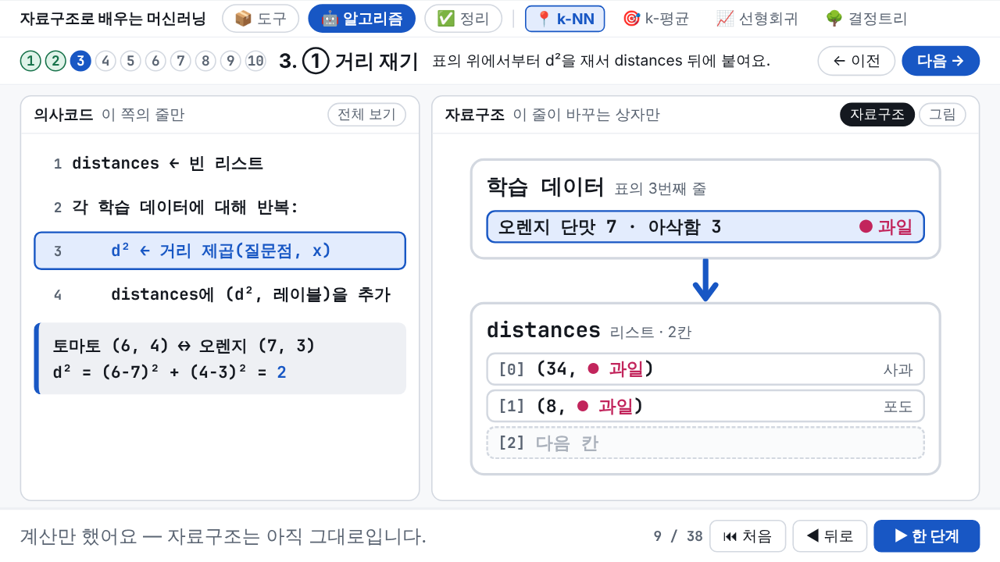
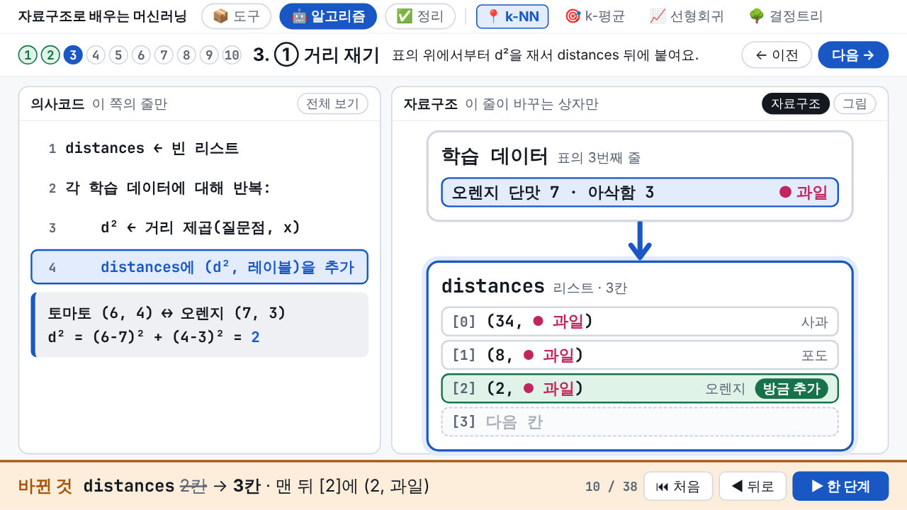
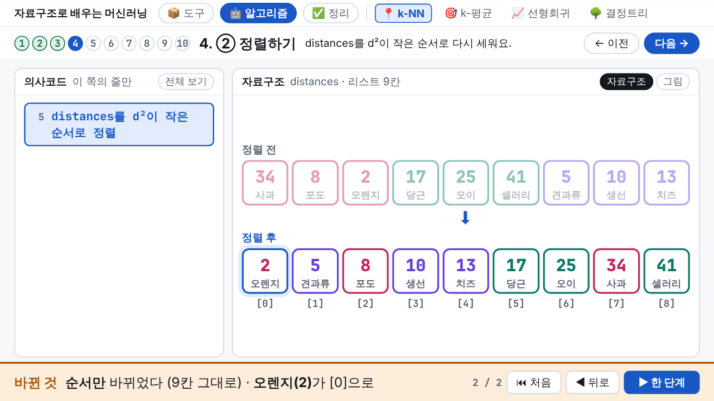
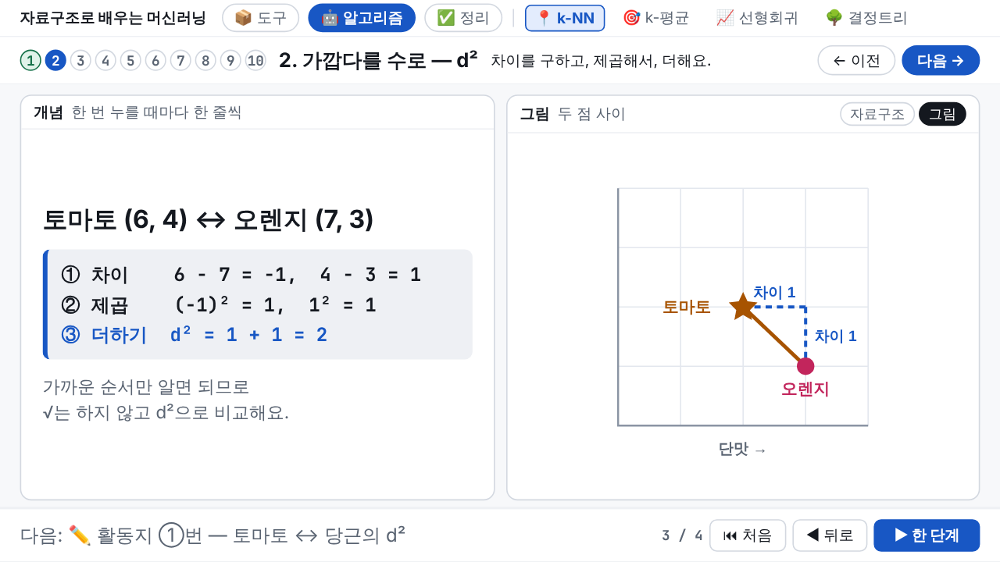

# 계획 변경 (v4) — 사이트 형태를 유지하고, 한눈에 보이는 정보를 줄인다

- **문서 버전**: v4.2 — **A단계 · B단계 개발 완료(2026-11-19)**, C단계(의사결정트리) 대기
  - A: 첫 화면(`index.html`)을 새 사이트 틀로, 📍 k-NN 탭 10쪽
  - B: 🎯 k-평균 탭 10쪽, 📈 선형회귀 탭 15쪽(1부 직선 · 오차 · 손실 · 손실 골짜기 / 2부 기울기 · 갱신 · 반복 · 학습률), 두 탭의 활동지 · 정답지 · 수업 대본 · 차시 안내(`teacher.html`)
  - 자동 점검(`scripts/budget.mjs`): 세 탭 35쪽 239단계 모두 기준 안
- **작성일**: 2026-11-16
- **바뀌는 것**: [PLAN-v3.md](./PLAN-v3.md)의 **화면 형태**(4장 · 7장 · 9장 · 10장). 슬라이드처럼 넘기는 "수업 화면"을 중심에 두려던 방향을 거둔다.
- **그대로인 것**: PLAN-v3의 점검 결과(2장), 풀어 쓴 수업 내용([장면 구성안](./docs/plan-v3/SCENES.md)), 보완할 자료(6장), 지시 외 수정(8장)

---

## 0. 한눈에 보기

| | v3 (어제 만든 것) | v4 (바꾸는 방향) |
|---|---|---|
| 화면 형태 | 슬라이드(PPT)처럼 한 장씩 넘기는 큰 무대 | **수정 전 사이트 그대로** — 큰 탭 → 쪽 → 의사코드와 자료구조가 나란히 있는 작업대 → 실행 단추 |
| 의사코드 | 위쪽 띠에 지금 줄 한 줄만 | **왼쪽 칸에 늘 보인다**(그 쪽의 줄들, 지금 줄 강조) |
| 이동 | 장면을 처음부터 끝까지 한 줄로 | 탭과 쪽 번호로 **어디든 바로**, 쪽 안에서는 ▶ 한 단계 · ◀ 뒤로 |
| 정보 줄이기 | 장면마다 화면을 새로 짬 | **같은 자리, 같은 틀**에서 보이는 것만 줄임 |

v3에서 확인된 좋은 점(한 번에 한 곳만 바뀜, `이전 → 지금` 자막, 큰 글씨, 교사 노트, 활동지)은 사이트 형태 안으로 가져온다.

같은 순간을 사이트 형태로 그린 시안(계획용 그림, `docs/plan-v4/`):

| ▶ 한 단계를 누르기 전 — 계산만 나왔다 | ▶ 한 번 더 — 자료구조만 바뀌었다 |
|---|---|
|  |  |
|  정렬 쪽 — 전과 후를 함께 |  개념 쪽 — 한 줄씩 |

---

## 1. 이렇게 이해했습니다 (다르면 알려 주세요)

1. **"수정 전 사이트의 형태"** = 큰 탭(📦 자료구조 도구 · 🤖 알고리즘 · ✅ 정리·확인) → 쪽 번호 → 의사코드 · 자료구조가 한 화면에 있는 작업대 → ▶ 한 단계로 밟는 형태. 지금 공개 주소의 `practice.html`(연습)이 그 형태다.
2. 그 형태에서 **불편했던 것은 형태가 아니라 양**이다 — 막대 5줄, 패널 3개에 상자 6 ~ 9개, 단추 30여 개, 작은 글씨, 한 번 누를 때 서너 곳이 함께 바뀜(PLAN-v3 2.2절).
3. 슬라이드 형태는 의사코드와 자료구조를 **한 틀에서 계속 견주어 보는** 이 사이트의 장점을 잃는다. 그래서 틀은 사이트로 두고, 그 안에서 줄인다.

---

## 2. 원칙 — 틀은 그대로, 보이는 것만 최소로

1. **자리는 고정.** 어느 쪽에서나 위 = 탭과 쪽, 왼쪽 = 의사코드, 오른쪽 = 자료구조, 아래 = 바뀐 것과 실행 단추. 쪽이 바뀌어도 배치가 바뀌지 않는다.
2. **칸은 둘.** 작업대는 `의사코드 | 자료구조` 두 칸이다. 그림(산점도 · 트리)은 오른쪽 칸에서 `[자료구조] [그림]` 단추로 **번갈아** 본다. 셋을 한꺼번에 띄우지 않는다.
3. **지금 필요한 것만.** 의사코드는 그 쪽의 줄만(전체 보기 단추), 자료구조는 **이 줄이 바꾸는 상자만**(원본 → 대상, 많아야 둘), 변수 · 표의 열도 그 쪽에 필요한 것만. 원본이 표일 때는 표 전체가 아니라 **지금 읽는 줄 하나**만 보인다.
4. **한 번에 한 곳.** ▶ 한 단계를 누르면 왼쪽(줄 · 계산)이나 오른쪽(자료구조) **한쪽만** 바뀐다. 아래 띠가 `distances 2칸 → 3칸`처럼 한 줄로 말한다.
5. **글은 두 줄.** 쪽 위의 한 문장, 아래 띠의 한 줄. 설명 문단은 화면에 두지 않고 교사 노트(`N`)로 옮긴다.
6. **큰 글씨.** 가장 작은 글자도 화면 높이의 2.4% 이상(1280×720에서 17px). 덜 보여 주는 만큼 키운다.
7. **단추는 셋.** 늘 보이는 실행 단추는 `⏮ 처음` `◀ 뒤로` `▶ 한 단계`. 재생 · 속도 · 예측 퀴즈 켜기는 ⚙ 안으로.

---

## 3. 화면 설계

```
┌─────────────────────────────────────────────────────────────────────────┐
│ 자료구조로 배우는 머신러닝  [📦 도구] [🤖 알고리즘] [✅ 정리]  │ 📍k-NN  🎯k-평균  📈선형회귀  🌳트리 │  탭 줄
├─────────────────────────────────────────────────────────────────────────┤
│ ①②❸④⑤⑥⑦⑧⑨⑩   3. ① 거리 재기   표의 위에서부터 d²을 재서 붙여요.      [← 이전] [다음 →] │  쪽 줄
├──────────────────────────────┬──────────────────────────────────────────┤
│ 의사코드 — 이 쪽의 줄만        │ 자료구조 — 이 줄이 바꾸는 상자만   [자료구조][그림] │
│  1 distances ← 빈 리스트      │                                          │
│  2 각 학습 데이터에 대해:      │   [표의 지금 줄]  ⬇  [distances]          │  작업대 (두 칸)
│  3   d² ← 거리 제곱(…)        │                                          │
│ ▶4   distances에 추가         │                                          │
│  ┌ 이 줄의 계산 ────────┐     │                                          │
│  │ d² = 1 + 1 = 2        │     │                                          │
├──────────────────────────────┴──────────────────────────────────────────┤
│ 바뀐 것  distances 2칸 → 3칸 · 맨 뒤 [2]에 (2, 과일)      10/38  [⏮ 처음][◀ 뒤로][▶ 한 단계] │  아래 띠
└─────────────────────────────────────────────────────────────────────────┘
```

### 3.1 수정 전 화면에서 줄이는 것

| 수정 전(알고리즘 단계 쪽) | v4 |
|---|---|
| 위쪽 막대 5줄 (제목 · 알고리즘 탭 · 쪽 안내 · 실행 제어 · 동작 카드) | **2줄** (탭 줄 · 쪽 줄) + 아래 띠 1줄 |
| 쪽 안내: 📘 배울 것 + ✋ 해 볼 것 두 문단 | 제목 + **한 문장** |
| 패널 3개 (의사코드 · 그림 + 계산 · 자료구조) | **2칸** (의사코드 + 그 줄의 계산 · 자료구조). 그림은 번갈아 보기 |
| 자료구조 상자 6 ~ 9개가 늘 보임 | 이 줄이 바꾸는 상자 **1 ~ 2개** (원본 표는 지금 줄 하나만) |
| 실행 단추 6개 + 속도 + 퀴즈 체크 + 진행 막대 | **3개** (+ ⚙) |
| 동작 카드(해설) + 계산 상자 + 줄 설명이 따로 | 아래 띠 한 줄 + 줄 바로 밑 계산 |
| 한 번 누르면 3 ~ 4곳이 함께 바뀜 | **한쪽만** (줄 · 계산 → 그다음에 자료구조) |
| 본문 12px, 그림 속 글자 6px (1280×720) | 본문 22 ~ 27px, 가장 작은 글자 17px |

### 3.2 "무엇이 바뀌었나"

PLAN-v3 4.4절의 규칙을 그대로 쓴다 — 새 칸에 "방금 추가", 옛 값에 줄 긋기(`0 → 1.96`), 정렬은 전 · 후를 함께, 바뀌지 않은 상자는 흐리게, 아래 띠는 늘 `이전 → 지금`. 놓쳤으면 `◀ 뒤로`와 `▶ 한 단계`로 다시 본다(움직임은 천천히, 약 1초).

### 3.3 수업할 때

- 키: `→` `Space` `PageDown` = ▶ 한 단계(쪽의 끝이면 다음 쪽으로), `←` `PageUp` = 뒤로 — 발표용 리모컨으로 수업 전체를 넘길 수 있다. `F` 전체 화면, `N` 교사 노트.
- **교사 노트**(`N`): 지금 쪽 · 지금 단계에서 할 말, 발문, 예상 답, 자주 하는 오해. 화면 아래에서 열리고 평소에는 보이지 않는다.
- **멈춤 질문**: 중요한 변화 앞에서 오른쪽 칸에 질문이 먼저 뜨고(지금의 🔮 예측 퀴즈 자리), 답은 다음 ▶에 나온다.
- 활동지 · 정답지 · 수업 대본 · 차시 안내는 지금의 교사용 자료 화면(`teacher.html`)을 그대로 쓴다.

---

## 4. 쪽 구성 — 풀어 쓴 내용을 "쪽"으로

[장면 구성안](./docs/plan-v3/SCENES.md)의 내용은 그대로 살리되, 슬라이드 43장이 아니라 **쪽 10개 안의 단계**로 담는다. 개념 설명도 같은 틀의 쪽이다(왼쪽에 한 줄씩 나오는 설명 · 계산, 오른쪽에 그림이나 표 하나).

| 탭 | 쪽 | 차시 |
|---|---|---|
| 📍 k-최근접 이웃 | 1 문제와 목표 · 2 개념: 가깝다를 수로(d²) · 3 ① 거리 재기 · 4 ② 정렬하기 · 5 ③ 앞에서 k개 · 6 ④ 투표하기 · 7 k를 바꾸면 · 8 정리 · 확인 문제 · 9 추적표 · 10 시험 대비 연습 | 1 |
| 🎯 k-평균 | 1 문제와 목표 · 2 개념: 평균과 중심 · 3 ① 묶음에 나누기 · 4 ② 새 중심 · 5 ③ 비교하고 바꾸기 · 6 2회차 · 7 수렴과 회차별 표 · 8 정리 · 확인 문제 · 9 추적표 · 10 연습 | 1 |
| 📈 선형회귀 | **1부** 1 문제와 목표 · 2 개념: 직선의 w, b · 3 개념: 오차와 손실 · 4 ① 예측 · 5 ② 오차 · 6 ③ 손실 · 7 손실 골짜기 / **2부** 8 개념: 손실의 기울기와 학습률 · 9 ④ 기울기 · 10 ⑤ 갱신 · 11 ⑥ 기록하고 반복 · 12 학습률을 바꾸면 · 13 정리 · 확인 문제 · 14 추적표 · 15 연습 | 2 |
| 🌳 의사결정트리 | **1부** 1 문제와 목표 · 2 개념: 질문으로 나누기 · 3 개념: 불순도와 가중 평균 · 4 ① 레이블 세기 · 5 ② 나누고 점수 매기기 · 6 ③ 질문 고르기 / **2부** 7 개념: 재귀와 스택 · 8 ④ 첫 가지 · 9 ⑤ 나머지 가지와 완성 · 10 트리로 예측 · 11 정리 · 확인 문제 · 12 추적표 · 13 연습 | 2 |
| 📦 자료구조 도구 · ✅ 정리·확인 | 지금 구성 유지. 같은 원칙(두 칸, 한 문장, 큰 글씨)으로 다듬는다 | 선택 |

쪽 번호가 많은 탭은 쪽 줄을 "1부 / 2부"로 묶어 보여 준다.

---

## 5. v3에서 가져가는 것 · 내려놓는 것

| 가져간다 | 내려놓는다 |
|---|---|
| 0단계 수정 전부 — 자동 게시와 버전 표시, 주소, 낡은 문제, d² 통일, "기울기" 정리 | 슬라이드 형태의 수업 화면(`class.html`)과 차시 고르기 홈 |
| 1차시의 풀어 쓴 내용 · 교사 노트 43개 · 확인 문제 · 활동지 · 정답지 → 쪽과 단계로 옮김 | 장면마다 화면을 새로 짜는 방식(표지 · 지도 · 질문 전용 화면 등) |
| 한 번에 한 곳, `이전 → 지금` 자막, 큰 글씨 기준, 천천히 움직이기 | |
| 교사용 자료 화면, 조사 도우미, 자동 점검(글자 크기 · 넘침 · 글자 수 · 한 번에 한 곳) | |

첫 화면은 다시 **사이트 자체**(📦 · 🤖 · ✅ 탭)가 된다. `class.html`은 시범 탭 확인이 끝나면 지운다.

---

## 6. 개발 단계

| 단계 | 만드는 것 | 확인 |
|---|---|---|
| **A** 시범 | 사이트 틀을 v4로(탭 줄 · 쪽 줄 · 두 칸 작업대 · 아래 띠 · 큰 글씨 · 키) + **📍 k-최근접 이웃 탭 10쪽** + 교사 노트. 첫 화면을 사이트로 되돌림 | **선생님 확인** — 한눈에 보이는 양, 글자 크기, 한 단계의 크기 |
| **B** | 🎯 k-평균, 📈 선형회귀(손실 골짜기 그림 포함), 활동지 | 확인 |
| **C** | 🌳 의사결정트리(스택 포함), 활동지 | 확인 |
| **D** | 📦 도구 · ✅ 정리 탭 다듬기, `class.html` 삭제, 문서 · 안 쓰는 코드 정리, 전체 자동 점검 | 완료 기준 |

A단계가 확인되기 전에는 다른 탭을 고치지 않는다.

---

## 7. 정해 주실 것

| # | 정할 것 | 기본값 |
|---|---|---|
| 1 | "수정 전 사이트"의 기준이 1장의 이해와 같은가 | 같다고 보고 진행 |
| 2 | 그림(산점도 · 트리)을 자료구조와 **번갈아** 볼지, 작게라도 **함께** 둘지 | 번갈아 보기(그림이 주인공인 쪽에서는 그림이 기본) |
| 3 | 의사코드를 그 쪽의 줄만 보일지, 늘 전체를 보일지 | 그 쪽의 줄만 + 전체 보기 단추 |
| 4 | 어제 만든 슬라이드형 수업 화면 | A단계 확인 뒤 삭제. 그때까지는 첫 화면에서만 내림 |
| 5 | 교사 노트 · 활동지 · 확인 문제 · 개념 쪽 | 모두 유지 |
| 6 | 차시 수 | 6차시(선형회귀 · 의사결정트리는 1부 / 2부) |

---

## 8. 완료 기준

1. 모든 쪽이 같은 틀이다 — 탭 줄, 쪽 줄, 두 칸 작업대, 아래 띠.
2. 단계 쪽에서 한눈에 보이는 것: 막대 2줄 + 아래 띠, 칸 2개, 자료구조 상자 2개 이하, 실행 단추 3개, 글자 300자 이하.
3. ▶ 한 단계마다 왼쪽이나 오른쪽 한쪽만 바뀌고, 아래 띠가 `이전 → 지금`으로 말한다.
4. 가장 작은 글자가 화면 높이의 2.4% 이상이다.
5. 탭과 쪽 번호로 어디든 바로 가고, 리모컨(→ / PageDown)만으로 한 차시를 끝까지 넘길 수 있다.
6. 위 2 ~ 4번을 자동 점검이 모든 쪽 · 모든 단계에서 확인한다.
